# PF PrintFloor

**Pomeroy Family PrintFloor**: a self-hosted web dashboard that shows the live status of a mixed 3D-printer
fleet (Bambu Lab, Snapmaker U1 / Klipper and Elegoo Centauri Carbon) on one page.

It is **status-only**: it never starts, pauses, cancels or changes anything on a printer. The only
things it can switch are a printer's **smart plug** (Govee) and the printer's **camera stream**.

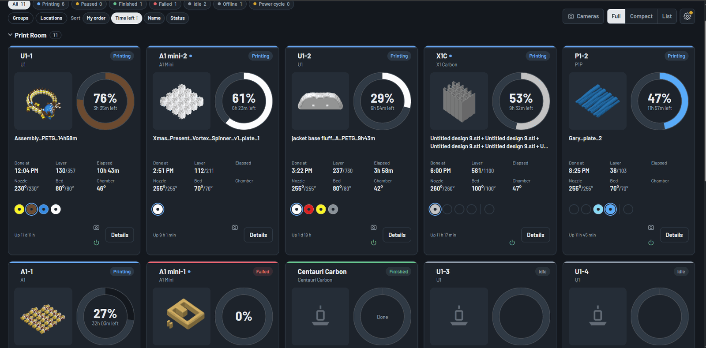

> Early release, shared for testing. Feedback and bug reports are welcome in
> [Issues](https://github.com/pomeroyfamily/pf-printfloor/issues).

## Contents

- [Features](#features)
- [Supported printers](#supported-printers)
- [Requirements](#requirements)
- [Installation](#installation)
  - [Docker (recommended)](#docker-recommended)
  - [Command line (Windows, Mac, Linux)](#command-line-windows-mac-linux)
  - [Build the image yourself](#build-the-image-yourself)
- [Updating](#updating)
- [Configuration](#configuration)
- [Using the dashboard](#using-the-dashboard)
  - [Install it as an app](#install-it-as-an-app-ipad-iphone-desktop)
- [Remote access and security](#remote-access-and-security)
- [Behavior notes and known limitations](#behavior-notes-and-known-limitations)
- [Diagnostic tools](#diagnostic-tools)
- [Development](#development)
- [Project layout](#project-layout)
- [Contributing](#contributing)
- [License](#license)

## Features

- **Live status per printer**: state, progress, time left and finish time, layer, temperatures, fans, errors.
- **Why a print paused or failed**, in plain words, on the card (status-label tooltip) and in Details.
- **Filament**: AMS / Canvas / U1 toolhead colors and materials, with the active slot highlighted.
- **Views**: Full cards, Compact cards and a List; all cards are always the same size.
- **Sorting** by your own order (drag and drop), time left, name or status; in the list view, also by job,
  progress or location (click a column name; click again to reverse).
- **Filters**: status chips, Groups (tags, maker, model) and Locations, combined.
- **Locations**: name places (e.g. "Garage", "Second Shop"), filter by them, group the grid into sections.
- **Dashboard name** shown as a banner (can be hidden).
- **Cameras**: per-card camera button and a camera wall; external camera URL per printer.
- **Smart plugs (Govee)**: on/off per printer, emergency stop with typed confirmation, optional automatic
  daily power cycle.
- **Uptime / last reboot** on the card where the printer allows it (see [notes](#uptime-and-reboot-detection)).
- **Job history and usage**: total hours, jobs, success rate, per-printer history, imported from the
  printer's own history where available.
- **Remote Bambu printers** through the Bambu cloud when they are not on the local network.
- **Firmware "update available"** notice for Bambu printers (notification only).
- **Light / Dark / Auto** appearance.

### Screenshots

| | |
|---|---|
| 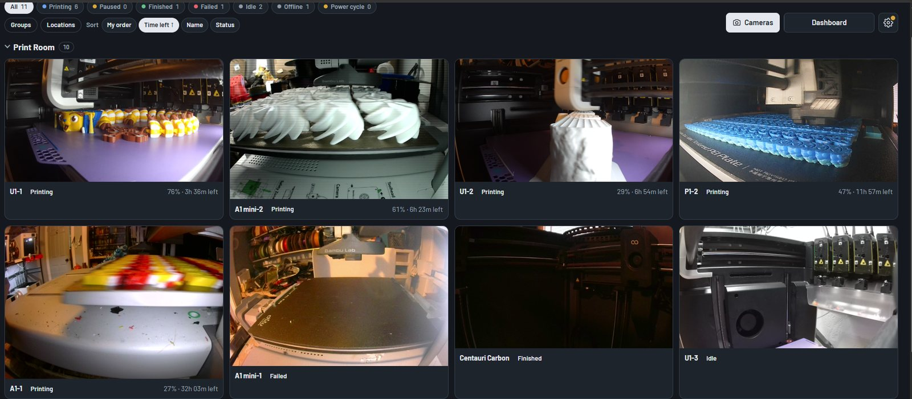 **Camera wall**: every camera at once, streaming only while open | 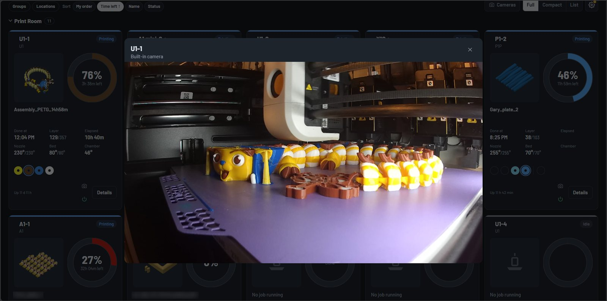 **One printer's camera** from its card |
| 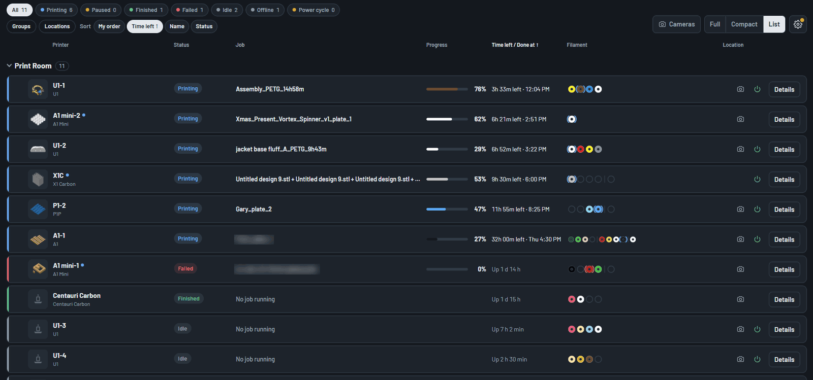 **List view**, sortable by any column | 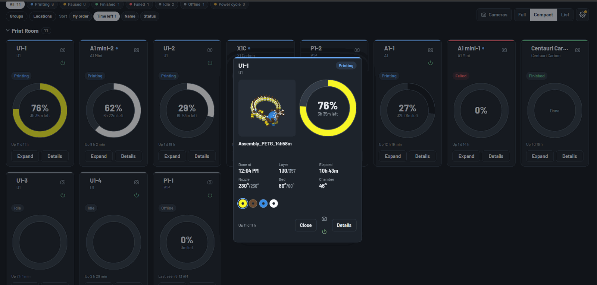 **Compact view**, a card expanded |
| 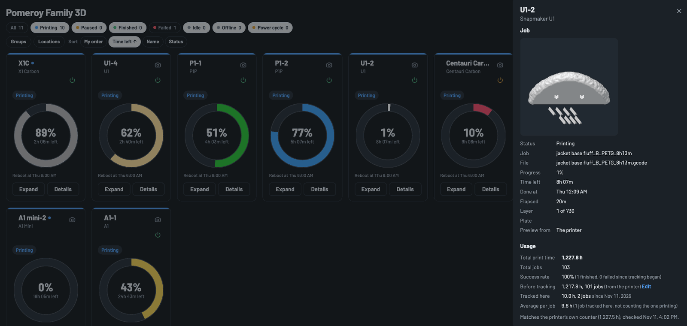 **Details**: job, print hours, average per job, history | 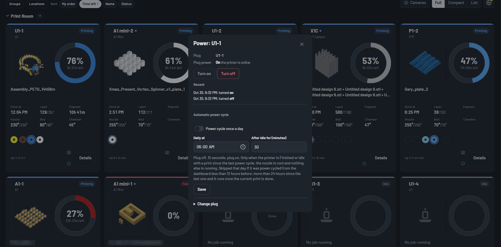 **Smart plug**: on/off and an optional daily power cycle |
| 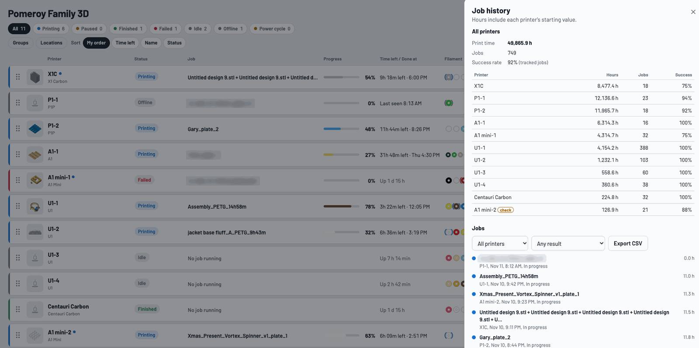 **Job history** for the whole fleet, with CSV export (light theme) | 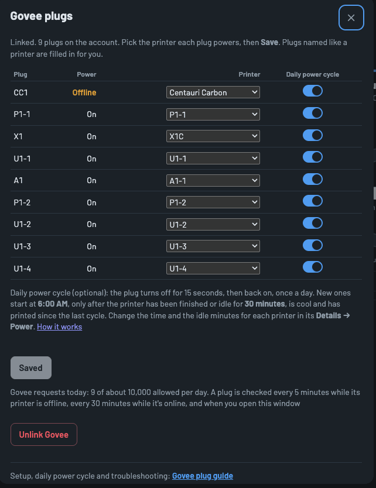 **Govee plugs**: which plug powers which printer, daily power cycle, offline plugs, request budget |
| 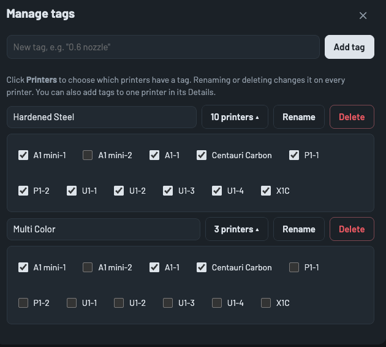 **Manage tags**: add tags and pick which printers have each one | 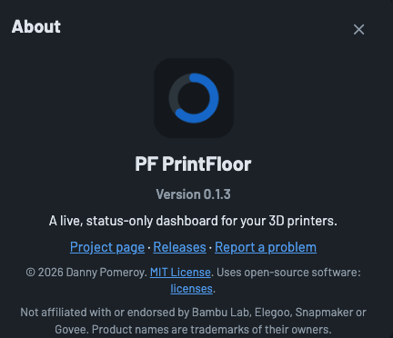 **About**: version and project links |

**On a phone**, light or dark:

| | | |
|---|---|---|
| 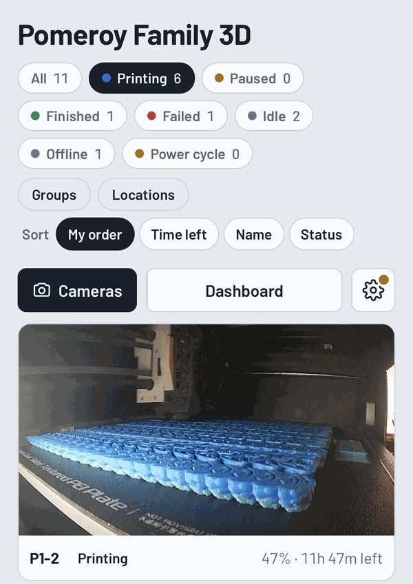 | 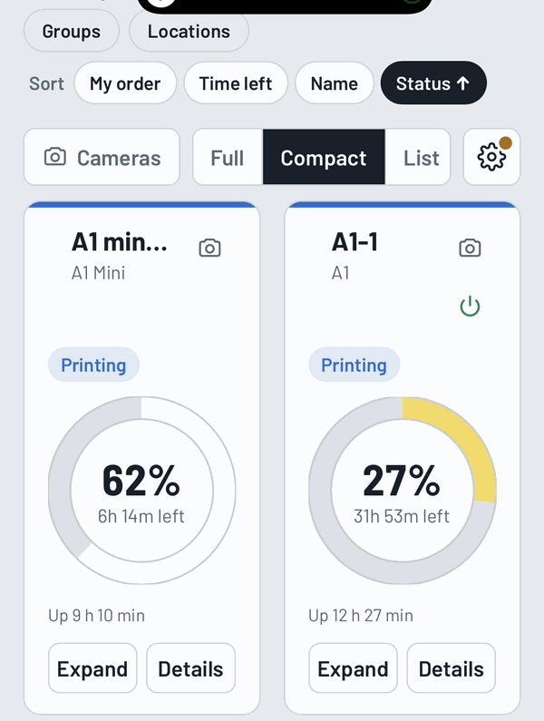 | 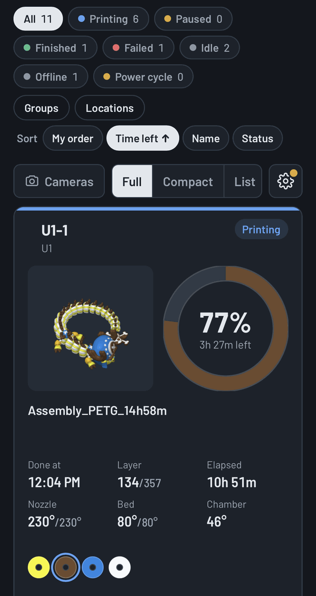 |

## Supported printers

| Printer | Driver | Connection | Camera | Pause reason | Uptime / reboot |
|---|---|---|---|---|---|
| [Bambu Lab X1 Carbon](docs/printers/bambu-lab.md) | `bambu.x1c` | Local MQTT, or Bambu cloud | Not yet (needs a relay, see notes) | Yes | Reboot detection |
| [Bambu Lab P1P](docs/printers/bambu-lab.md) | `bambu.p1p` | Local MQTT, or Bambu cloud | Yes (~0.5–2 fps stills) | Yes | Reboot detection |
| [Bambu Lab A1 / A1 Mini](docs/printers/bambu-lab.md) | `bambu.a1`, `bambu.a1mini` | Local MQTT, or Bambu cloud | Yes (~0.5–2 fps stills) | Yes | Reboot detection |
| [Snapmaker U1](docs/printers/snapmaker-u1.md) | `snapmaker.u1` | Moonraker HTTP (local only) | Yes; smooth video with [extended firmware](docs/printers/snapmaker-u1.md#camera-stock-firmware-vs-extended-firmware) | Yes | Real uptime |
| [Generic Klipper](docs/printers/klipper.md) | `klipper.generic` | Moonraker HTTP (local only) | External URL | Yes (if reported) | Real uptime |
| [Elegoo Centauri Carbon](docs/printers/elegoo-centauri-carbon.md) | `elegoo.cc1` | SDCP WebSocket (local only) | Yes (MJPEG, [viewer limit](docs/printers/elegoo-centauri-carbon.md#camera)) | No (shown as "Paused") | Reboot detection |

**Printer notes** (cameras, quirks, what each one can and can't report): click a printer above, or
[Bambu Lab](docs/printers/bambu-lab.md) · [Snapmaker U1](docs/printers/snapmaker-u1.md) ·
[Elegoo Centauri Carbon](docs/printers/elegoo-centauri-carbon.md) · [Generic Klipper](docs/printers/klipper.md).

Anycubic Kobra 3 is planned, not built.

## Requirements

- **Docker**, or **Python 3.11+** to run it directly.
- A computer that stays on, on the **same network as the printers** (a home server or NAS, a Raspberry Pi 4/5, a mini PC).
- Finding printers by itself uses network broadcasts (Bambu SSDP on UDP 2021/1990, U1 mDNS, Elegoo UDP 3000),
  so in Docker it needs **host networking**. Without it you can still add printers by IP address.
- Optional: a Bambu Lab account (cover images for cloud prints, print hours, cloud connection for remote
  printers, automatic access-code recovery) and a Govee API key (smart plugs).

## Installation

After installing, open `http://<that computer's IP>:8765` and add printers from the gear menu (⚙ → Add printer).
Everything you set up is kept in one data folder; updates never touch it.

### Docker (recommended)

A ready-made image is published for x86-64 and ARM64 (Raspberry Pi): `ghcr.io/pomeroyfamily/pf-printfloor`.

With Docker Compose, download [`docker-compose.yml`](docker-compose.yml), set your time zone in it, then:

```sh
docker compose up -d
```

Or with plain Docker:

```sh
docker run -d --name pf-printfloor --network host --restart unless-stopped \
  -e TZ=America/Los_Angeles -v printfloor-data:/data ghcr.io/pomeroyfamily/pf-printfloor:latest
```

**Where your data lives.** By default in the Docker volume `printfloor-data`: nothing to prepare, Docker creates
it. (`printfloor-data:` with nothing after it at the bottom of the compose file is intentional.) It's kept when
you update, but `docker compose down -v` or removing the app's volumes deletes it.

To keep it in a folder you choose instead (easier to back up and snapshot, e.g. on a NAS):

1. Create the folder and make it writable by user `568`, which the container runs as:
   `sudo mkdir -p /path/to/folder && sudo chown 568:568 /path/to/folder`
   (TrueNAS: a dataset with the **Apps** permission preset does the same.)
2. In `docker-compose.yml`, replace `- printfloor-data:/data` with `- /path/to/folder:/data` and delete the
   `volumes:` block at the bottom.

If the container keeps restarting with `unable to open database file` in its log, the folder isn't writable by
568 (step 1).

**Docker Desktop (Windows / Mac):** host networking may not be available, so printer discovery may not work.
Use port mapping instead (replace `--network host` with `-p 8765:8765`) and add printers by IP address. Running
from the command line (below) avoids this.

### Command line (Windows, Mac, Linux)

Needs Python 3.11 or newer.

```sh
git clone https://github.com/pomeroyfamily/pf-printfloor.git
cd pf-printfloor
python -m venv .venv
```

Then install and start it:

| | Windows (PowerShell) | Mac / Linux |
|---|---|---|
| Install | `.venv\Scripts\pip install -r requirements.txt` | `.venv/bin/pip install -r requirements.txt` |
| Start | `.venv\Scripts\python -m app` | `.venv/bin/python -m app` |

Start it from the project folder. Data is stored in `data/` there (change with `PRINTER_DASH_DATA`). Stop it with
Ctrl+C. On Windows, allow Python through the firewall when asked, or discovery can't hear the printers.

### Build the image yourself

From the project folder:

```sh
docker build -t pf-printfloor:local .
```

Then use `image: pf-printfloor:local` in `docker-compose.yml` (and `pull_policy: never`), or `pf-printfloor:local`
in the `docker run` command. After pulling new source, build again and recreate the container
(`docker compose up -d`).

**NAS app screens and Docker managers** (Portainer and similar): use the same settings as `docker-compose.yml`:
host networking, a writable folder or volume mounted at `/data`, and `PRINTER_DASH_PORT` if 8765 is taken.

## Updating

Your printers, sign-ins, history and settings are in the data folder / volume and are kept. The app upgrades its
database by itself when it starts.

| Installed with | Update |
|---|---|
| Docker Compose | `docker compose pull && docker compose up -d` |
| Docker | `docker pull ghcr.io/pomeroyfamily/pf-printfloor:latest`, then `docker rm -f pf-printfloor` and the same `docker run` command as before |
| Command line | `git pull`, then the Install command again, then start it |
| Built yourself | `git pull`, then the build command again, then `docker compose up -d` |

If the page looks unchanged afterwards, reload it once (Ctrl+F5).

To stay on one version, use a version tag instead of `latest`, e.g. `ghcr.io/pomeroyfamily/pf-printfloor:0.1.0`.
Releases are listed on the [Releases](https://github.com/pomeroyfamily/pf-printfloor/releases) page.

## Configuration

Environment variables:

| Variable | Default | Purpose |
|---|---|---|
| `PRINTER_DASH_DATA` | `./data` (`/data` in Docker) | Data folder: SQLite database and thumbnails. Keep it on a local disk, not a network share. |
| `PRINTER_DASH_PORT` | `8765` | Port the web server listens on. |
| `PRINTER_DASH_HOST` | `0.0.0.0` | Address to listen on. |
| `PRINTER_DASH_LOG` | `INFO` | Log level. |
| `TZ` | `UTC` | Time zone; used for the automatic power cycle if none is set in the app. |

Everything else is configured in the app (gear menu):

- **Add printer**: from your Bambu account, from a network search (U1 / Klipper / CC), or by IP.
- **Bambu account**: sign in (email code or authenticator app). The token is stored server-side only.
- **Govee plugs**: paste your Govee API key, then pick which printer each plug powers. Full walkthrough:
  [docs/govee.md](docs/govee.md). The key is stored server-side only and never shown again.
- **Dashboard & locations**: dashboard name, banner on/off, locations and the default location.
- **Manage tags**: add tags, choose which printers have each one, rename or delete them everywhere.
- **Job history**, **Appearance**.

## Using the dashboard

- **Details** (button on every card): everything about one printer, plus its settings: name, IP, access code,
  location, connection mode (Bambu), camera URL, tags, plug, automatic power cycle, card position, remove.
- **Status label tooltip**: hover the "Paused" / "Failed" label to see why (useful in Compact view).
- **Card bottom line** shows, most important first: "Last seen …" when offline, the automatic power cycle
  ("Reboot in 12 min", with pause / restart buttons), or uptime ("Up 3 d 4 h").
- **Locations** button: pick locations to show, and switch **Group by location** on to split the grid into
  sections (click a section header to fold it). Dragging cards works within a section; move a printer to another
  location in Details.
- **Cameras** button: camera wall; it follows the current filters and grouping.
- **Power button** on a card (only when a plug is assigned): green = on, red = off, yellow = plug not online.

Filters, sort, view and grouping are remembered **per browser**. The dashboard name, locations, printers and
all other settings are **shared** by every browser.

### Install it as an app (iPad, iPhone, desktop)

The dashboard can sit on your home screen and open full screen, without the browser bars. It's the same
dashboard, using your dashboard name and the PF PrintFloor icon.

- **iPad / iPhone (Safari):** open the dashboard → **Share** → **Add to Home Screen** → **Add**. Works on your
  local network address (for example `http://192.168.1.50:8765`).
- **Android (Chrome):** menu (⋮) → **Add to Home screen** or **Install app**.
- **Desktop (Chrome / Edge):** the install icon in the address bar. Chrome and Edge only offer this on
  `https://` or `localhost`; on a plain `http://` network address use a bookmark instead.

In the installed app there's no browser reload button, so **Settings → Reload** appears there. Renaming the
dashboard later doesn't rename an icon already on the home screen; remove it and add it again.

## Remote access and security

The dashboard has **no login of its own**, and it can switch printers off through their plugs. Anyone who can
reach the page can use it.

- On the home network, treat it like any other unauthenticated LAN service.
- **Do not expose it to the internet without authentication.** A Cloudflare Tunnel with **Cloudflare Access**
  in front works well: create a self-hosted Access application for the hostname with an *Allow* policy listing
  specific email addresses, and turn on **Protect with Access** (JWT validation) on the tunnel's published
  application. Press Enter after pasting the AUD tag; the field takes a list.
- The U1 "Smooth video" button connects directly to the printer and only works on the home network.

Secrets (Bambu access codes, the Bambu account token, the Govee API key) are stored in the data folder and are
never sent to the browser.

## Behavior notes and known limitations

These are deliberate rules or printer quirks that can look odd.

### Status and connections

- **How fast a printer shows Offline** after it disappears: Bambu ~30–90 s (connection drop or 90 s of
  silence), U1 ~10 s (polled every 3 s), CC ~20 s (polled every 15 s). The dashboard keeps retrying
  (up to once a minute) and the card recovers by itself.
- **"Last seen"** is the last time the printer itself reported, not when the dashboard gave up. It is saved, so
  it survives a dashboard restart.
- **Bambu P1P / A1** send changes only; a full refresh is requested at most every 5 minutes because the P1P lags
  when asked more often. The X1C sends full reports.
- **Bambu filament remaining %** is not available over the local connection (the printer reports 0 on
  firmware 01.12 even when the screen shows a value), so it is hidden.
- **CC Canvas filament** is read every 5 minutes while idle and every 2 minutes while printing (disable the
  printing reads with the `canvas_while_printing` setting). Between reads, the last values are shown.
- **CC pause reasons are not available**: the printer does not report why it paused over the network (checked
  during a real "filament or spool may be jammed" pause). The card just says "Paused".
- **U1 pause reasons** come from `print_stats.exception` (e.g. "Paused: filament tangled (Toolhead 2)") and are
  only shown while the printer is paused or in error, because the U1 may keep the message after resuming.
- **Bambu pause reasons** come from the printer's stage or error code; texts are from the ha-bambulab table.
  An unknown code shows no text rather than a guess.

### Printer names

- **"Use the printer's name"** (Details → Edit): the card shows the name the printer reports and follows it when
  you rename the printer (Bambu Studio / Handy, Fluidd / Mainsail, the printer's screen). Name sources: Bambu = its
  network announcement (heard on this network only), U1 / Klipper = Moonraker's `device_name`, or the host name
  if there is none; CC = the name it reports.
- A printer added with the name left blank follows its own name from the start. **Typing a name** turns following
  off; ticking the box turns it back on and takes the printer's current name at once.
- A printer that never reports a name keeps the one it has.
- **Job history shows each printer's current name**, including jobs from before a rename (history follows the
  printer, not its name). The CSV export does the same.

### Bambu access codes

- The LAN **access code changes** when a Bambu printer is set up again (new Wi-Fi, removed and re-added in Bambu
  Handy). The card then shows **Access code rejected**.
- With a **linked Bambu account**, the dashboard fixes this by itself: on a rejected code it reads the printer's
  current code from the account (at most every 5 minutes per printer), connects with it and saves it.
- Without a linked account, enter the new code in Details → Edit (on the printer: Settings → WLAN / Network shows
  it).

### Bambu printer on a new address

- A new Wi-Fi network or DHCP lease can give a printer a **new IP address** (the card shows `unreachable` / `No route
  to host`). Bambu printers announce their address on the network, and the dashboard follows a printer it knows
  (same serial number) to the new one by itself. Details shows "changed from … on …".
- Because the access code is sent to that address, it only moves when **all** of these hold: the announcement
  came from the new address itself, the old address no longer answers, and the new address presents a certificate
  issued to the printer's serial number. Otherwise it stays put (see the log) and you can change it in Details.
- A host **name** (e.g. `p1.local`) is never replaced, only IP addresses. Printers away from this network (cloud
  connection) aren't heard, so nothing changes for them.

### Bambu account sign-in

- When Bambu stops accepting the saved sign-in (anywhere: cover images, cloud connection, access-code recovery,
  Add printer), the dashboard **remembers it**, also across restarts: the gear gets an orange dot and Settings →
  Bambu account says to sign in again. Until then those cloud features are off. Signing in again clears it.

### Bambu cloud connection (remote printers)

- Each Bambu has **Connection: Automatic / This network only / Bambu cloud only** (Details). Default: Automatic.
- **Automatic** uses the local connection. If that fails for **2 minutes**, and a Bambu account is linked, and the
  printer is on that account and not marked offline there, it switches to the cloud. While on the cloud it checks
  the local network every **10 minutes** and switches back when the printer answers.
- While on the cloud the card shows a **"via cloud"** tag, the **camera button is hidden** and previews only come
  from the account (cloud-started prints); files can't be read from the printer.
- Your home printers can briefly show "via cloud" if the machine running the dashboard loses them on the network; they switch back within
  10 minutes.
- The cloud connection details come from community projects and have only been tested against a stand-in
  server so far. The printer must stay in normal cloud mode (not LAN Only).

### Cameras

- **P1P / A1 / A1 Mini** cameras send still pictures, about 0.5–2 per second. There is no video stream on these
  models; smooth video needs an external camera.
- **X1C** sends real video (RTSPS, port 322) that browsers can't play; a relay inside the dashboard is planned.
  It needs **LAN Mode Liveview** turned on in the printer's network settings (LAN Only Mode is not needed).
- **U1 stock firmware**: the camera only produces pictures while it is asked every few seconds, ~1–3 fps.
- **U1 with the [extended firmware](docs/printers/snapmaker-u1.md#camera-stock-firmware-vs-extended-firmware)**
  (paxx12): snapshots plus an optional "Smooth video" (WebRTC, home network only).
- **CC**: the stream is switched on when someone watches and off again 10 seconds after the last viewer leaves.
  The printer allows only a few viewers at once, including Elegoo's apps
  ([details](docs/printers/elegoo-centauri-carbon.md#camera)).
- Streams run only while a card, popup or the camera wall is open; a background browser tab stops pulling frames.

### Uptime and reboot detection

- **U1 / Klipper**: real uptime from Moonraker (`/machine/proc_stats`, read every 5 minutes).
- **Bambu**: no uptime is reported. A reboot is detected when the report counter (`sequence_id`) starts over
  (a drop of more than 50, seen twice in a row). The time shown is when the dashboard noticed, usually within a
  minute. A Bambu shows **no uptime until the first reboot the dashboard has seen**. A reboot while the dashboard
  was down is caught when it comes back and dated then; it corrects itself on the next reboot.
- **Centauri Carbon**: no uptime or counter. After power-on its position reads exactly `0,0,0` until it moves;
  homing gives a real position. Moved/homed → `0,0,0` is treated as a reboot, dated when noticed. A reboot
  followed by a move before the dashboard's next poll (15 s) is missed.

### Smart plugs (Govee)

Setup (getting the API key, linking it, matching plugs to printers) and troubleshooting:
**[docs/govee.md](docs/govee.md)**.

- **Rate limit**: Govee allows about 10,000 requests a day. Background polling stops after 3,000 of the
  dashboard's own requests (or when fewer than 2,000 remain), so on/off and emergency stop always have room.
- **Plug state** is read every 5 minutes for printers that are not online. An online printer's plug is assumed to
  be on (except for 5 minutes after the dashboard turned it off) and is read every 30 minutes, so an unplugged
  plug shows as offline.
- **Emergency stop**: turning a plug off while the printer is printing, paused, receiving a file, has a hot
  nozzle (> 50 °C), is installing a firmware update or drying in the AMS requires typing the printer's name.
- **Turn on waits 15 seconds** after a turn off (the power supply must discharge).
- Every command is **checked by reading the plug back**, and re-sent once if it didn't switch. If the plug
  can't be read, the result is shown as "unconfirmed".

### Automatic power cycle

Optional per printer, **off by default**, only when a plug is assigned (Details → Power). Plug off, 15 s, plug on.
It runs only when **all** of these hold:

- A print has happened since the last reboot.
- The printer is online and **Finished or Idle**. Failed, cancelled, paused or error never qualify:
  someone should look at those first.
- It has been in that state for the configured **idle minutes** (the countdown).
- Nozzle under 50 °C; not printing, preparing or receiving a file; no firmware update or AMS drying in progress
  (Bambu; any unrecognized update state counts as "updating").
- The plug is on. A plug that is already off is never switched on.
- The daily time has come (local time zone), **unless the printer rebooted less than 12 hours before it**.
  If more than **24 hours** have passed since the last reboot (for example a long print ran through the daily
  time), it runs at the first moment the rules allow.

Other details:

- "Last reboot" = the latest of the dashboard's power cycles (manual or automatic) and the printer's own boot
  time where it can be detected (see above). Turning a printer back on from the dashboard counts as a power cycle.
- **Pause** skips the next cycle and clears itself at the following daily time. **Restart countdown** starts the
  idle minutes again. Anyone viewing the dashboard can use both.
- Printers are cycled **at least a minute apart**.
- If the dashboard or the machine running it restarts in the middle of a cycle, the plug is turned back on at startup. The "on" step
  retries for about 3 minutes; if it still fails the card shows "Reboot failed" and it tries again after 30 minutes.
- Turning it on for a printer sets the starting point to "now", so the first cycle is at a daily time at least
  12 hours later.
- The time zone is taken from the first browser that saves these settings, else `TZ`, else UTC.

### History and usage

- An imported job (from the printer's own history) is merged with a tracked job if it has the same id or started
  within 15 minutes of it.
- Bambu account print hours are in seconds on the X1C and minutes on the P1P / A1 / A1 Mini.
- The usage check against Bambu counters counts finished prints only, because the printer's counter does.

### Other

- **Firmware update available** is shown for Bambu printers only (confirmed on the X1C). It is a notice; updates
  are applied on the printer.
- **New-printer alerts** (a "!" on the gear when a new printer is found) are designed but not built yet.

## Diagnostic tools

Read-only scripts in [`tools/`](tools). Run them inside the container from the project folder, for example:

```sh
docker exec -i pf-printfloor python - "Centauri Carbon" \
    < tools/pause_probe.py > pause_CC.json
```

| Script | What it does |
|---|---|
| `pause_probe.py` | Dumps everything a U1 or CC reports (use while paused, or before/after a reboot). |
| `bambu_seq_probe.py` | Prints a Bambu's report counters (reboot detection check). |
| `x1c_camera_probe.py` | Checks whether the X1C camera stream (RTSPS 322) answers. |
| `camera_probe.py` | Measures camera frame rates per printer. |
| `govee_probe.py` | Lists Govee plugs and their state (key typed at a hidden prompt). |
| `ftp_range_check.py` | Checks Bambu FTPS ranged reads (thumbnail download). |
| `gen_bambu_filaments.py` | Regenerates the Bambu filament preset table. |

None of them change anything on a printer or plug; secrets are never printed.

## Development

```sh
python -m venv .venv
.venv/bin/pip install -r requirements-dev.txt     # Windows: .\.venv\Scripts\pip ...
.venv/bin/python -m pytest -q                      # runs against in-process fake printers
.venv/bin/python -m app                            # http://localhost:8765
```

Releasing: set the version in `pyproject.toml`, then push a tag `vX.Y.Z`. GitHub runs the tests, starts the
built container once as a check, and only then publishes the image (`X.Y.Z`, `X.Y` and `latest`). If the release
changes the database, first add an upgrade fixture with `tools/make_upgrade_fixture.py`, so
`tests/test_upgrade.py` proves older data still opens.

Watch one printer from the terminal (prints the normalized status every 5 s):

```sh
python -m app.cli drivers
python -m app.cli watch --driver bambu.x1c --host 10.0.0.90 --code <access code>
```

Tests use real status dumps from printers, with serials and addresses replaced (`tests/fixtures/`), and fake printers / clouds (`tests/fakes/`).

## Project layout

```
app/
  web.py                 FastAPI app: REST API, server-sent events, static files
  manager.py             runs the drivers, history, plugs, locations, reboot tracking
  models.py              one normalized status model for every printer
  store.py               SQLite: printers and app settings (secrets kept out of the UI view)
  history.py             job history, usage, audit against the printers' own counters
  cameras.py             camera sources and the shared frame hub
  plugs.py               Govee client, rate budget, power actions and log
  autocycle.py           automatic power cycle scheduler
  cloud/bambu.py         optional Bambu account link (covers, devices, cloud MQTT login)
  drivers/
    base.py              lifecycle, reconnect/backoff, live vs poll mode
    bambu/               X1C, P1P, A1, A1 Mini (MQTT, FTPS thumbnails, error texts)
    klipper/             Snapmaker U1, generic Klipper (Moonraker)
    sdcp/                Elegoo Centauri Carbon (SDCP, Canvas)
  discovery/             Bambu SSDP listener, U1 / Klipper network search
  transports/            MQTT, FTPS, HTTP, WebSocket, TLS helpers
  static/                index.html, app.css, app.js (no build step)
docker-compose.yml       Docker Compose for any machine
Dockerfile               the image
.github/workflows/       tests on every change; tested image published for each release
tests/                   pytest suite, fixtures, fakes
tools/                   diagnostic probes
```

Class rule: printers that share a **protocol** get a family base class with a child per model. Shared
**transports** are helpers, not parent classes.

## Contributing

Bug reports and ideas: open an [issue](https://github.com/pomeroyfamily/pf-printfloor/issues). Include the
printer model and firmware, and what the card showed.

Code changes: fork the repo, make your change on a branch, run the tests (`python -m pytest -q`; they use
built-in fake printers, no real printers needed), and open a pull request. Every pull request is reviewed
before it is merged.

Never include access codes, tokens, API keys, serial numbers or IP addresses from your own setup in issues,
logs or test files.

## License

[MIT](LICENSE). Third-party data is listed below.

## Third-party data

Bambu error texts come from [ha-bambulab](https://github.com/greghesp/ha-bambulab) (MIT). See
[`LICENSES-THIRD-PARTY.md`](LICENSES-THIRD-PARTY.md).
